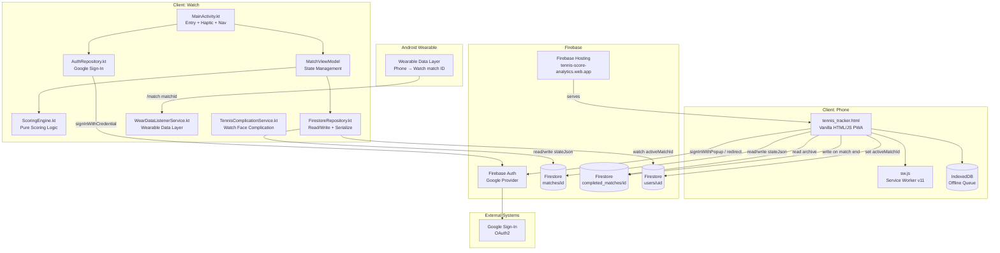

# System Architecture

## Overview
Breakpoint is a real-time tennis scoring system with two independent clients — a phone PWA and a Kotlin Wear OS watch app — that share a single Firebase backend. All business logic runs client-side; Firebase Firestore handles bidirectional sync with no custom server.

## Architecture Diagram

## Layer Summary

| Layer | Purpose | Key Components |
|-------|---------|----------------|
| Presentation (Phone) | Scoring UI, stats, archive, spectator mode | `tennis_tracker.html` (single-file SPA) |
| Presentation (Watch) | Wrist scoring UI, sign-in, match ID entry | `ScoreScreen.kt`, `SignInScreen.kt`, `MatchIdScreen.kt` |
| State (Watch) | Reactive state management, coroutine flows | `MatchViewModel.kt` |
| Business Logic | Tennis scoring rules (pure, no side effects) | `ScoringEngine.kt`, JS scoring functions in PWA |
| Data / Sync | Firestore read/write, state serialization | `FirestoreRepository.kt`, Firestore JS SDK in PWA |
| Auth | Google Sign-In, Firebase credential exchange | `AuthRepository.kt`, Firebase Auth JS in PWA |
| Offline | IndexedDB write queue, flush on reconnect | IndexedDB in PWA (`tsa_offline` DB) |
| Infrastructure | Hosting, static asset cache | Firebase Hosting, Service Worker |
| Watch Integration | Watch face complication, phone→watch match ID push | `TennisComplicationService.kt`, `WearDataListenerService.kt` |

## External Integrations

- **Firebase Auth (Google)** — Google OAuth2 sign-in on both phone and watch; shared UID links both clients to the same Firestore data
- **Firebase Firestore** — single source of truth for match state; real-time sync via `onSnapshot` (phone) and `addSnapshotListener` Flow (watch)
- **Firebase Hosting** — CDN delivery of the PWA; no server-side rendering
- **Android Wearable Data Layer** — one-way channel used exclusively to push the current match ID from phone to watch at match start
