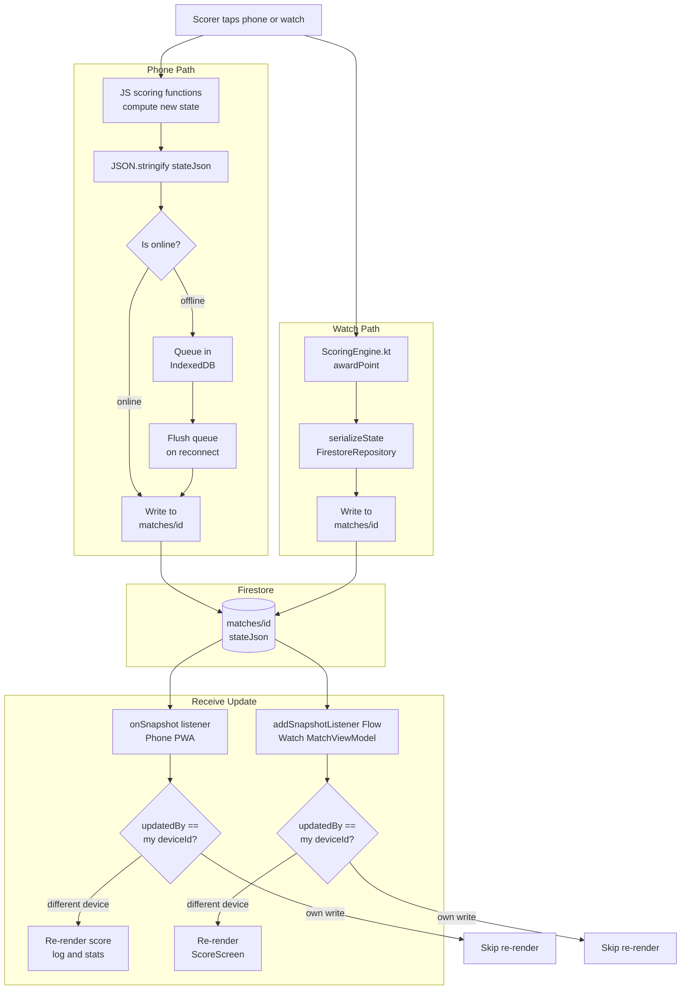
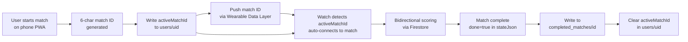

# Data Flow

## Overview
Data enters the system when a scorer taps to award a point on either the phone or the watch. The scoring engine computes the new state client-side, serializes it to JSON, and writes it to Firestore. The other client receives the update via a real-time Firestore listener and re-renders. The Wearable Data Layer is used only for the initial match ID handshake.

## Primary Scoring Flow

## Match Lifecycle Flow

## Data Pipelines

| Pipeline | Source | Processing | Destination |
|----------|--------|-----------|-------------|
| Point award (phone) | Tap on player name | JS scoring engine → JSON serialize | Firestore `matches/{id}` |
| Point award (watch) | Tap on screen half | `ScoringEngine.awardPoint` → `serializeState` | Firestore `matches/{id}` |
| Live sync (phone) | Firestore `onSnapshot` | Parse `stateJson` → re-render UI | Phone screen |
| Live sync (watch) | Firestore Flow snapshot | `parseState` → ViewModel state | Watch screen |
| Offline queue flush | `online` event | Dequeue IndexedDB → batch Firestore writes | Firestore `matches/{id}` |
| Match archive | Match `done=true` | Extract summary + full point log | Firestore `completed_matches/{id}` |
| Watch auto-connect | Firestore `users/{uid}.activeMatchId` | Watch listener detects change → join match | Watch scoring session |
| Match ID push | Phone starts match | Wearable Data Layer path `/match` key `matchId` | Watch `WearDataListenerService` |
| Spectator join | URL `?match=ID` | Read-only Firestore listener | Phone read-only view |

## Integration Points

- **Inbound:** Scorer taps (phone touch, watch gesture), Google Sign-In token
- **Outbound:** Firestore writes (`matches`, `completed_matches`, `users`), Wearable Data Layer message
- **Bidirectional:** Firestore real-time listeners on both clients
- **Async:** IndexedDB offline queue (phone only), service worker cache (PWA assets)
- **Read-only:** Spectator clients listen to `matches/{id}` without writing
