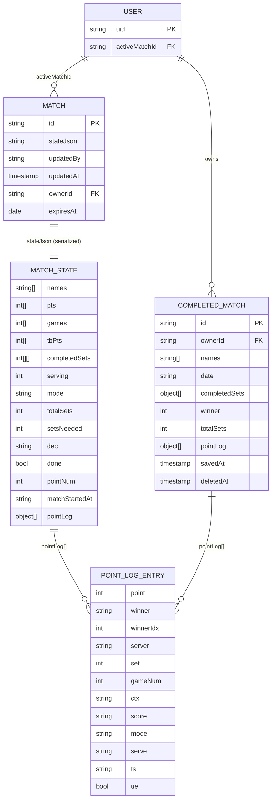

# Data Model

## Overview
All match state is stored as a single serialized JSON blob (`stateJson`) in Firestore. There is no relational schema — the entire match history and scoring state travels as one atomic document. Both clients (PWA and watch) parse and write the same JSON format.

## Entity Relationship Diagram

## Key Entities

| Entity | Purpose | Key Fields | Relationships |
|--------|---------|------------|---------------|
| `users/{uid}` | Per-user state | `activeMatchId` | References `matches` |
| `matches/{id}` | Active/in-progress match | `stateJson`, `updatedBy`, `ownerId`, `expiresAt` | Owned by `users` |
| `completed_matches/{id}` | Archive of finished matches | `ownerId`, `names`, `completedSets`, `winner`, `pointLog`, `deletedAt` | Owned by `users` |
| `MatchState` (embedded) | Full match scoring state | `pts`, `games`, `tbPts`, `completedSets`, `mode`, `serving`, `done` | Embedded in `stateJson` |
| `PointLogEntry` (embedded) | Single point record | `winner`, `serve`, `ts`, `ue` | Array in `MatchState.pointLog` |

## Data Stores

| Store | Type | Purpose |
|-------|------|---------|
| Firestore `matches` | NoSQL document | Real-time active match sync between all clients |
| Firestore `completed_matches` | NoSQL document | Persistent match archive, soft-deletable |
| Firestore `users` | NoSQL document | Per-user active match pointer for watch auto-connect |
| IndexedDB `tsa_offline` | Browser key-value | Offline write queue for PWA (phone only); flushes on reconnect |
