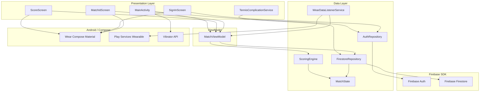

# Module Dependencies

## Overview
The watch app has a clean layered architecture: presentation → viewmodel → data layer. The PWA is a single-file architecture with no module boundaries — all logic lives in `tennis_tracker.html`. Both clients share no code; the Firestore `stateJson` schema is the contract between them.

## Watch App Dependency Graph

## Coupling Analysis

| Module | Fan-In | Fan-Out | Assessment |
|--------|--------|---------|------------|
| `MatchState.kt` | 2 (SE, FR) | 0 | Stable leaf — safe to extend, impacts both consumers |
| `ScoringEngine.kt` | 1 (VM) | 1 (MatchState) | Well-isolated — pure functions, easy to unit test |
| `FirestoreRepository.kt` | 2 (VM, Comp) | 2 (MatchState, Firestore SDK) | Central I/O — changes here affect sync for both clients |
| `AuthRepository.kt` | 2 (Main, SIS) | 1 (Firebase Auth) | Stable — thin wrapper |
| `MatchViewModel.kt` | 3 (Main, SS, MIS) | 2 (SE, FR) | High fan-in — core state hub, modify carefully |
| `MainActivity.kt` | 0 | 3 (VM, AR, Haptic) | Entry point — low risk for logic changes |
| `WearDataListenerService.kt` | 0 | 2 (Wearable, VM) | Background service — receives match ID from phone |
| `TennisComplicationService.kt` | 0 | 1 (FR) | Independent — reads Firestore directly for watch face |
| `tennis_tracker.html` (PWA) | 0 | Firebase JS SDK | Monolith — all logic co-located, no internal coupling |

## Circular Dependencies

None detected. The watch app dependency graph is strictly acyclic (data layer ← viewmodel ← presentation). The PWA has no module structure to analyze.

## Cross-Client Contract

The only dependency between the PWA and the watch app is the `stateJson` schema stored in Firestore. This is an implicit contract — no shared code, no shared types. Both sides must stay in sync when the schema changes. See [docs/data-model.md](../../docs/data-model.md) for the full schema.
